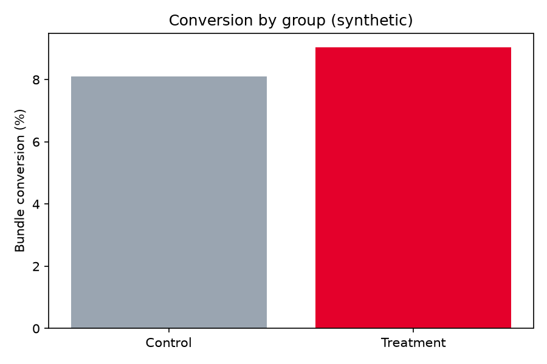
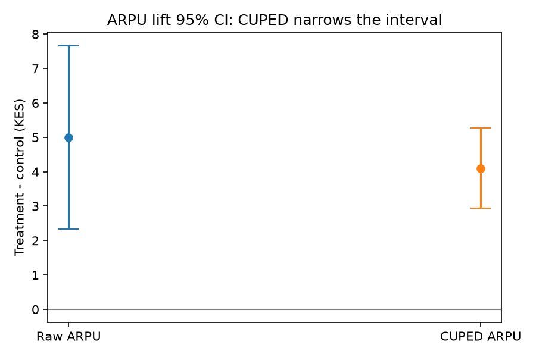
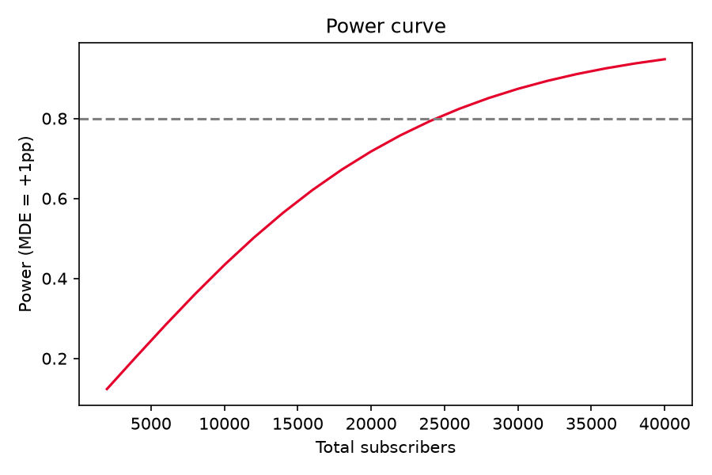

# Telco A/B Testing: "Bundle ya Wiki" USSD Offer Prompt

[](https://github.com/ChristopherKiokoStrathmore/telco-ab-testing/actions/workflows/ci.yml)

> **Data notice:** all data in this repository is **synthetic**, generated by a seeded script (`src/abtest/data.py`, seed 42).
> It is **not** Airtel data or data from any other operator, and the numbers below only demonstrate the method.

## Problem
A Kenyan mobile operator wants to know whether showing prepaid subscribers a personalised weekly airtime-bundle prompt
on the USSD menu (treatment) increases **bundle conversion** and **30-day ARPU** compared with the standard menu (control),
without increasing **USSD opt-outs** or **complaints** (guardrails).

## Approach
| Step | Method | Code |
|---|---|---|
| 1. Design | Power analysis → required sample size for +1pp MDE on an 8% base, α=0.05, power=0.8 | `stats.sample_size_two_prop` |
| 2. Randomisation check | Sample-ratio-mismatch (SRM) chi-square test | `stats.srm_check` |
| 3. Primary metric | Two-proportion z-test + 95% CI for absolute and relative lift | `stats.two_prop_ztest` |
| 4. Secondary metric | Welch difference in ARPU, then **CUPED** using pre-period ARPU | `stats.cuped` |
| 5. Guardrails | Opt-out and complaint rates must not rise significantly | `run.py` |
| 6. Peeking caution | Simulated A/A tests checked 10 times show inflated false positives | `stats.peeking_false_positive_rate` |
| 7. Decision | Ship/no-ship memo generated automatically | `reports/decision_memo.md` |

## Results (synthetic)
| Metric | Result |
|---|---|
| Required n per group | 12,208 (actual: 20,076 / 19,924) |
| SRM p-value | 0.45: randomisation healthy |
| Conversion | 8.09% → 9.04%, **+0.95pp (95% CI +0.40 to +1.50)**, +11.7% relative, p = 0.0007 |
| ARPU lift (raw) | KES +5.00 (CI +2.33 to +7.67) |
| ARPU lift (CUPED) | KES +4.10 (CI +2.93 to +5.28): **81% variance reduction** |
| Guardrails | Opt-out +0.16pp (p=0.10), complaints −0.10pp (p=0.12): no significant harm |
| Peeking 10× in an A/A test | 18% false-positive rate vs the nominal 5% |
| **Decision** | **SHIP**, with a staged 25% → 100% rollout and live guardrail monitoring |





## Why peeking matters
If a test is checked daily and stopped the first time p < 0.05, the real false-positive rate is far higher than 5%
(18% with 10 looks in the simulation). Either fix the sample size in advance, as here, or use a sequential method
(alpha spending such as O'Brien-Fleming, or always-valid p-values).

## How to run
```bash
python -m venv .venv && source .venv/bin/activate
pip install -r requirements.txt
pytest -q                          # unit tests
PYTHONPATH=src python -m abtest.run  # regenerates data, figures and the decision memo
jupyter notebook notebooks/analysis.ipynb
```

## Structure
```
src/abtest/   data.py (synthetic generator) · stats.py (tests, CUPED, power) · run.py (pipeline)
tests/        pytest unit tests
notebooks/    walkthrough notebook
reports/      figures/, decision_memo.md, results.json
```
MIT licence · Author: Christopher Nguu
